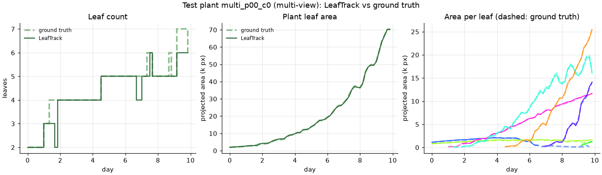

# LeafTrack

**Leaf instance segmentation, tracking, and growth analytics for top-down plant time-lapse imagery.**

> Segmentation, tracking and growth analytics are built and evaluated, with a Gradio demo and a REST API. The hosted demo link is coming soon.


*Two test plants the model never saw in training, one image every 4 hours for 10 days. Each leaf keeps its color and number for as long as it is visible. Left: multi-view rig; right: RGB-D rig.*

## What it does

1. **Segment** every leaf in a top-down plant image with a YOLO11-seg model.
2. **Track** each leaf across a time-lapse sequence so it keeps a stable ID.
3. **Analyze** growth: leaf count, per-leaf area, and growth rate over time.

## Project structure

```
leaftrack/        Core package: segment, metrics, evaluation, training, hub, track, analytics
data/scripts/     Dataset download, conversion (to YOLO-seg), splitting, visual checks
configs/          Training configs and the committed plant-level split
train.py          Training entry point (used by Colab/Kaggle notebooks)
evaluate.py       Segmentation evaluation and results table
evaluate_tracking.py  Tracking evaluation, baselines and the demo GIF
evaluate_growth.py    Growth analytics vs ground truth
analyze_growth.py     Growth analysis of your own image folder
api/              FastAPI service (segment, analyze)
app.py            Gradio demo
deploy/           Hugging Face Space packaging and deploy script
notebooks/        Thin GPU launcher notebooks
tests/            pytest suite
```

## Dataset

[KOMATSUNA](http://limu.ait.kyushu-u.ac.jp/~agri/komatsuna/) (Uchiyama et al., 2017): 1,200 labelled top-down frames of 10 plants over 10 days, with leaf identities that stay consistent over time. That makes it a fit for both segmentation and tracking evaluation.

The data is converted to YOLO-seg polygons and split **by plant, not by frame**, so no plant seen in training appears in validation or test. See [data/README.md](data/README.md) for the verified data format, conversion quality and split. Datasets and model weights are never committed.

## Results

Test split: 240 images of 2 held-out plants (one per capture rig).

| Model | Params | Mask mAP50 | Mask mAP50-95 | SBD ↑ | FBD ↑ | \|DiC\| ↓ | Exact leaf count | CPU latency* |
|---|---|---|---|---|---|---|---|---|
| **[YOLO11n-seg](https://huggingface.co/Awais05/leaftrack-yolo11n-seg)** (demo model) | 2.8 M | **0.987** | **0.825** | 0.930 | 0.970 | 0.15 | 85% | **241 ms** |
| [YOLO11s-seg](https://huggingface.co/Awais05/leaftrack-yolo11s-seg) | 10.1 M | 0.965 | 0.806 | **0.934** | **0.971** | **0.15** | **87%** | 523 ms |

\* Median per image at 640 px on 2 CPU threads, matching the free Hugging Face Spaces tier.

- **The nano model is the right choice for the demo.** It matches the small model within 0.004 SBD and is 2.2× faster on CPU.
- **SBD / FBD / DiC** are the [CVPPP leaf segmentation](https://link.springer.com/article/10.1007/s00138-015-0737-3) metrics. SBD measures how well each leaf is segmented, FBD how well the plant is separated from the background, and |DiC| the error in leaf count.
- **How the leaf metrics are computed:** with post-processing chosen on the **validation** plants (confidence threshold, and NMS IoU 0.5), so the test plants stay unseen, scored against the original color labels.

### What made the difference

COCO mAP looked excellent from the start, but leaf counting was off by 1.4 leaves per image. The cause was not the model: multi-view crops contain **leaves of neighbouring plants** at the image edge, which the labels correctly ignore. LeafTrack drops edge leaves that never reach toward the plant centre. On the ground truth this rule removes 0 of 5,820 true leaves.

| YOLO11n, test split | SBD ↑ | \|DiC\| ↓ | Exact leaf count |
|---|---|---|---|
| Ultralytics default (conf 0.25) | 0.746 | 1.38 | 26% |
| + threshold selected on validation (0.30) | 0.756 | 1.27 | 28% |
| + neighbour-leaf filter | **0.930** | **0.15** | **85%** |

Full reports, including per-rig breakdowns, are written by `evaluate.py` (`metrics.json`, `results.md`, `per_image.csv`).


*Segmentation on test plants, early to late growth: image, prediction, ground truth.*

## Leaf tracking

Every leaf gets a stable ID across the time-lapse. The default tracker is **ByteTrack** (Ultralytics' implementation): it matches boxes with a Kalman filter in two stages, and its second stage uses *low-confidence* detections to continue existing tracks, which keeps a partly covered leaf's ID while its segmentation flickers. On 2 CPU threads it adds about 3 ms per frame to segmentation (237 → 240 ms).

```python
from leaftrack.pipeline import track_frames
from leaftrack.segment import LeafSegmenter

segmenter = LeafSegmenter.from_hub("Awais05/leaftrack-yolo11n-seg", conf=0.30)
for leaves in track_frames(frames, segmenter):  # time-ordered RGB images of one plant
    for leaf in leaves:
        print(leaf.track_id, leaf.instance.area)
```

LeafTrack also includes its own tracker, `LeafTracker` (`track_frames(..., tracker="leaftrack")`). Frames are 4 hours apart, so it skips motion modelling and matches each detection to the existing tracks by **mask overlap** with the Hungarian algorithm. The cost combines IoU with overlap of the smaller mask, so a whole leaf wins over a fragment of it, and a track survives up to 10 missed frames.

Test split: 4 sequences (3 camera views of one plant, one RGB-D plant), 240 frames, 28 leaves. The ground-truth IDs are KOMATSUNA's per-leaf label colors. `LeafTracker` settings were selected on the validation plants.

| Method (YOLO11n masks) | IDF1 ↑ | MOTA ↑ | ID switches ↓ | Mostly tracked ↑ | Val IDF1 |
|---|---|---|---|---|---|
| Per-frame IDs (no tracking) | 0.323 | 0.678 | 309 | 4% | — |
| LeafTracker without track memory | 0.945 | 0.950 | 13 | 93% | — |
| LeafTracker (mask overlap) | 0.949 | **0.952** | 11 | 96% | 0.886 |
| **ByteTrack (default)** | **0.968** | **0.952** | **6** | 96% | 0.886 |
| LeafTracker on ground-truth masks | 0.973 | 0.988 | 13 | 96% | — |

- **IDF1** measures how consistently each leaf keeps one ID over its whole life; **MOTA** combines misses, false detections and ID switches; **mostly tracked** is the share of leaves followed by one ID for at least 80% of their frames.
- **Why ByteTrack is the default:** the two trackers tie on validation (IDF1 0.886). On test, ByteTrack makes about half as many ID switches (6 vs 11) and is easy to swap for any Ultralytics tracker.
- **Tracking quality is now limited by segmentation.** Given ground-truth masks, `LeafTracker` reaches 0.973 IDF1. The ID switches left there happen when a leaf changes shape faster than a 4-hour interval can follow, such as an old seed leaf (cotyledon) being covered by new growth.
- **Approaches that did not help on validation:** a centroid-distance fallback for low-overlap pairs, and a ByteTrack-style low-confidence pass inside `LeafTracker`.


Reports (`metrics.json`, `results.md`, `per_sequence.csv`), the GIF and this filmstrip are written by:

```bash
python evaluate_tracking.py --weights runs/segment/yolo11n/weights/best.pt --device 0
```

## Growth analytics

From the tracked leaves LeafTrack measures, per frame and per leaf:

- **Leaf count** and **total projected leaf area** of the plant.
- **Area of every leaf over time**, in pixels, or in mm² when you give the pixel size.
- **Relative growth rate (RGR)**, the slope of ln(area) over time per day (0.69/day means the area doubles daily). For the plant it is fitted over a trailing 24 h window, one full day-night cycle, because leaves move during the day and the visible area swings by 15-30% between captures. For each leaf it is fitted over the leaf's first 48 h, its exponential phase, before it levels off.
- **Absolute growth rate** (area per hour) over the same windows.

Results come as tidy pandas tables (one row per leaf per frame, per frame, per leaf) plus a growth dashboard.

**How accurate is it?** On the test plants, the same analytics computed from the predictions (YOLO11n + ByteTrack) and from the ground-truth label masks agree closely:

| Trait (test split, 240 frames, 28 leaves) | Agreement with ground truth |
|---|---|
| Leaf count per frame | exact in 82% of frames, mean error 0.18 leaves |
| Total leaf area per frame | median error 1.7%, r = 1.000 |
| Plant RGR (24 h window) | mean error 0.024 per day, r = 0.90 |
| Area per leaf per frame | median error 2.6% (95% of leaf-frames followed by the leaf's track) |
| Maximum area per leaf | median error 1.4% |
| Early RGR per leaf (first 48 h) | mean error 0.14 per day, r = 0.94 |



*One test plant: predictions (solid) against ground truth (dashed). Each ground-truth leaf and the track that follows it share a color.*

The leaf count is exact slightly less often than in segmentation alone (82% vs 85%) because ByteTrack confirms a new leaf's track one frame after it first appears.

**Analyze your own time-lapse** (a folder of top-down images of one plant, in file-name order). Weights download from the Hub:

```bash
python analyze_growth.py --images path/to/plant_frames --interval-hours 4
```

This writes `leaves.csv`, `plant.csv`, `leaf_summary.csv`, `dashboard.png` and `tracking.gif`. Use `--times times.csv` (`filename,hours`) for uneven capture times and `--mm-per-px` for physical units. In Python:

```python
from leaftrack.pipeline import analyze_sequence

result = analyze_sequence(frames, hours, segmenter)  # frames: RGB arrays, hours: capture times
result.plant      # leaf_count, total_area_px, rgr_per_day, agr_px_per_h per frame
result.leaves     # one row per leaf: lifespan, max area, early growth rates
result.records    # one row per leaf per frame
```

The accuracy report is reproduced with `python evaluate_growth.py --device 0`.

## Demo and API

**Gradio demo** (`app.py`): pick an example plant or upload the frames of one plant to get a tracking animation with stable leaf colors, growth charts, a per-leaf table and CSV downloads. A second tab segments and counts the leaves in a single image. It runs on CPU: the 60-frame example plant takes about 6 s on 2 CPU threads, and larger 480 px frames about 0.25 s each.

```bash
pip install -e ".[demo]"
python app.py            # http://localhost:7860
```

The example plants are the KOMATSUNA test and validation plants (never seen in training), **downloaded on demand from the official dataset server**. The dataset page grants no redistribution licence, so no dataset images are stored in this repository or the demo.

**REST API** (`api/main.py`, FastAPI, docs at `/docs`):

```bash
uvicorn api.main:app --port 8000
curl -F "image=@plant.png" http://localhost:8000/segment
curl -F "images=@day1.png" -F "images=@day2.png" -F "interval_hours=24" http://localhost:8000/analyze
```

| Endpoint | Input | Output |
|---|---|---|
| `GET /health` | | status, version, model |
| `POST /segment` | one image | leaves: polygon, box, area, confidence |
| `POST /analyze` | frames of one plant (in order), `interval_hours`, `tracker` | leaves per frame with track IDs, plant traits per frame, per-leaf growth summary |

Both load the published model from the Hugging Face Hub (or a local file via `LEAFTRACK_WEIGHTS`). `python deploy/deploy_space.py --repo <user>/leaftrack` publishes the demo as a Hugging Face Space (code only; the model and examples are fetched at runtime).

## Training

Training runs on a free T4 via the launcher notebooks ([Colab](notebooks/train_colab.ipynb), [Kaggle](notebooks/train_kaggle.ipynb)) or on any local GPU:

```bash
pip install -e ".[train]"
python data/scripts/download_komatsuna.py     # ~125 MB, resumable
python data/scripts/convert_komatsuna.py
python data/scripts/split_dataset.py
python train.py --config configs/train_yolo11n.yaml --project runs/segment --name yolo11n
python evaluate.py --weights runs/segment/yolo11n/weights/best.pt --device 0
```

- **Recipe:** pretrained YOLO11-seg, 640 px, cosine LR, early stopping, plus full-rotation and vertical-flip augmentation (top-down plants have no canonical orientation).
- **Checkpoints:** written every 10 epochs, and `--resume` continues an interrupted run from `last.pt`.
- **These results** come from a laptop RTX 3050 (6 GB). YOLO11n trained with a 150-epoch budget, early-stopped at epoch 116 (best epoch 73), in 42 minutes. YOLO11s trained for 80 epochs at batch 8 in 53 minutes. The configs now default to 80 epochs with patience 20.

## Pretrained weights

Both models are on the Hugging Face Hub, each with its test metrics and a model card:
[`Awais05/leaftrack-yolo11n-seg`](https://huggingface.co/Awais05/leaftrack-yolo11n-seg) and
[`Awais05/leaftrack-yolo11s-seg`](https://huggingface.co/Awais05/leaftrack-yolo11s-seg).

```python
from leaftrack.segment import LeafSegmenter

segmenter = LeafSegmenter.from_hub("Awais05/leaftrack-yolo11n-seg", conf=0.30)
leaves = segmenter.predict(rgb_image)  # list of LeafInstance: mask, box, confidence, area
```

`conf=0.30` is the threshold selected on the validation plants. Weights are published with `python -m leaftrack.hub` and never committed to git.

## Development

```bash
python -m venv .venv
source .venv/bin/activate   # Windows: .venv\Scripts\activate
pip install -e ".[dev]"
pytest
```

## License

[MIT](LICENSE)
